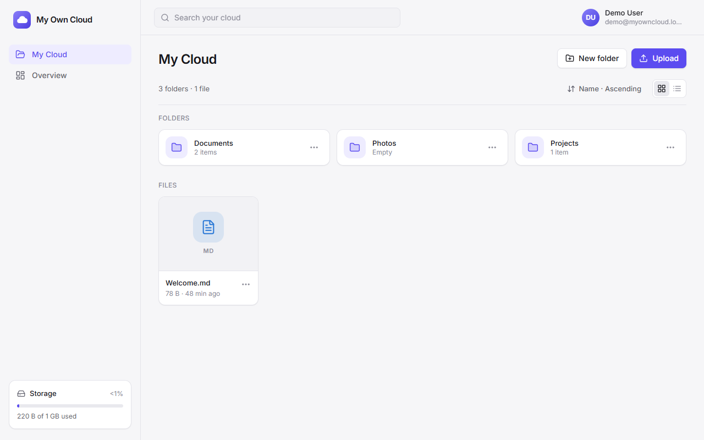
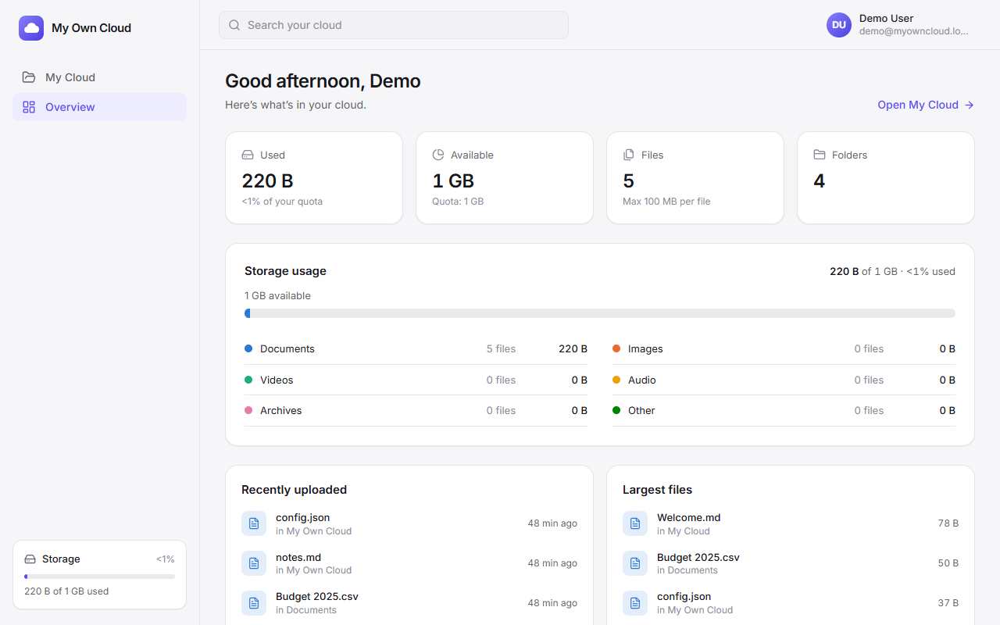
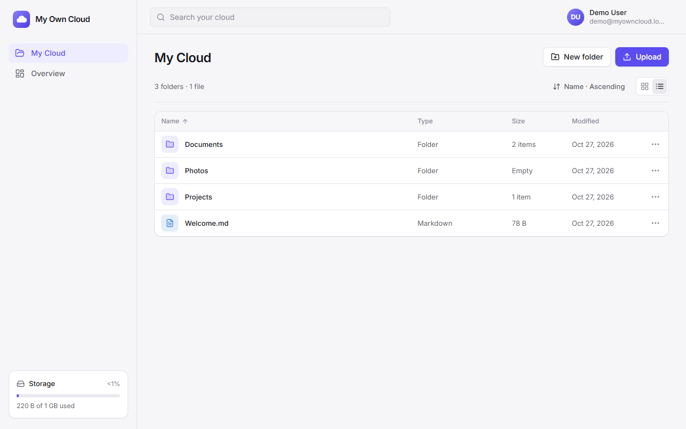
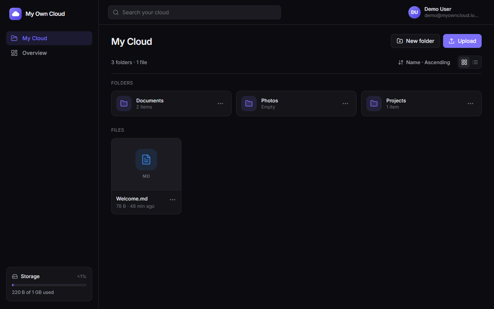
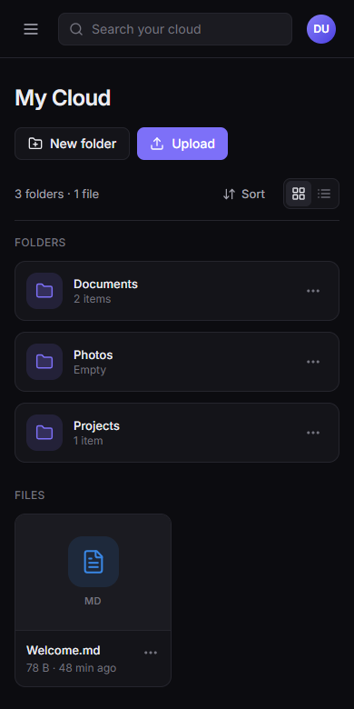

# My Own Cloud

A self-hosted personal cloud-storage web app. Users sign up, upload files, organise them into folders, and search, preview and download them through a responsive React interface. Everything runs on my own Express REST API and PostgreSQL database, with no third-party backend service.



## Why I built it

Services like Google Drive and Dropbox hide the interesting engineering: session handling, per-user access control, safe handling of untrusted uploads, and quota accounting that stays correct under concurrency. I wanted to build those parts myself, end to end, and test them properly.

**Intended users:** individuals who want a private file store they run themselves. As a portfolio piece, it's also aimed at engineers reviewing how I approach a full-stack system.

## Features

All of these are implemented and covered by automated tests (see [Testing](#testing)).

- **Accounts** — registration, sign-in and sign-out with server-side sessions; passwords hashed with bcrypt.
- **Uploads** — file picker or drag-and-drop, several files at once, per-file progress with cancel and retry.
- **Files** — download, image thumbnails and preview, rename, move, delete. Duplicate names become `report (1).pdf` instead of overwriting.
- **Folders** — nesting, breadcrumbs, rename, move (dialog or drag onto a folder), and delete with all contents. Moving a folder into its own subtree is rejected.
- **Search & sorting** — case-insensitive name search across all folders; sort by name, size, modified or upload date; grid and list views.
- **Storage dashboard** — used and available space, file and folder counts, usage by file type, recent and largest files.
- **Per-user quota** enforced on the server, including when uploads arrive at the same time.
- **Interface** — responsive layout with a mobile navigation drawer, light/dark/system themes, keyboard-accessible menus and dialogs, and loading, empty and error states.

| Overview | List view | Dark theme | Mobile |
|---|---|---|---|
|  |  |  |  |

## Tech stack

| Area | Technology | Why |
|---|---|---|
| Frontend | React 19, TypeScript, Vite | Typed component model; fast dev server with an `/api` proxy |
| Styling | Tailwind CSS 4 | Semantic design tokens as CSS variables, so themes swap variables only |
| Data fetching | TanStack Query, React Router | Caching and invalidation of server state; client-side routing |
| API | Node.js, Express 5, TypeScript | Small, explicit REST API; Express 5 forwards async errors to the error handler |
| Validation | Zod | One schema per request body, route parameter and query string |
| Database | PostgreSQL 17, `pg` | Relational integrity (foreign keys, unique and check constraints), row locks, recursive CTEs |
| Uploads | multer, file-type | Streams uploads to disk; detects the real file type from its bytes |
| Security | bcryptjs, helmet, express-rate-limit, cors | Password hashing, security headers, brute-force limits, origin allow-list |
| Testing | Vitest, Supertest, Playwright (playwright-core) | Unit and API tests in-process; browser end-to-end test in installed Edge/Chrome |

## Architecture

```
React SPA ──/api (same origin)──► Express API ──► PostgreSQL   (users, sessions, folders, file metadata)
                                      │
                                      └────────► StorageDriver ──► private disk directory (file bytes)
```

- **One origin.** In development, Vite proxies `/api` to Express; in production, Express also serves the built SPA. The session cookie therefore needs no cross-site configuration.
- **Layered backend.** Each module (`auth`, `folders`, `files`, `drive`, `storage-stats`) is split into routes → controller (Zod validation) → service (business rules, transactions) → repository (parameterised SQL).
- **Authentication.** Login sets an `HttpOnly`, `SameSite=Lax` cookie (also `Secure` in production) holding a random 256-bit token; the database stores only its SHA-256 hash. Each request resolves the cookie to a user; logout deletes the session row.
- **Authorization.** Every query is scoped by `user_id`, and another user's resource returns `404`, exactly like a missing one. The schema also has composite foreign keys `(folder_id, user_id) → folders(id, user_id)`, so PostgreSQL itself refuses to put a file in someone else's folder.
- **File storage.** Bytes go to a private directory under server-generated UUID names; the database keeps the metadata. The storage code sits behind a `StorageDriver` interface, so S3-compatible storage could replace it without touching routes or services.

More detail: [Architecture & security](docs/ARCHITECTURE.md) · [Database schema](docs/DATABASE.md) · [REST API reference](docs/API.md)

## What makes it technically meaningful

- **Quota that stays correct under concurrency.** Each upload runs in a transaction that locks the user's row (`SELECT … FOR UPDATE`) before checking the quota and inserting. A test fires 5 parallel uploads at a quota that fits 3, and exactly 3 succeed.
- **Upload and database stay consistent.** The file record is inserted and the bytes are moved into storage inside one transaction; on any failure both are rolled back. Deletes remove the database rows first, then the bytes, so a crash can leave orphaned bytes but never a broken record. `npm run storage:gc` finds and removes orphans.
- **Untrusted input is handled defensively.**
  - The browser-supplied MIME type is ignored; the type is detected from the file's bytes.
  - Path components are stripped from filenames, and storage keys must be UUIDs.
  - Downloads are served as attachments with `nosniff` and a sandboxing CSP. Only raster images are ever shown inline.
- **Tree integrity.** Moving a folder checks its subtree with a recursive CTE, under the same per-user lock, so two concurrent moves can't combine into a cycle.
- **Tested from the database up to the browser:** constraint tests run directly against PostgreSQL, a second user attempts every cross-user operation, and an 18-step browser test drives the real UI.

## Getting started (Windows)

**Requirement:** Node.js 20 or newer. No PostgreSQL install or admin rights are needed: `npm run db:start` runs the official PostgreSQL 17 binaries (from the `embedded-postgres` package) inside the project folder on port 5433.

```powershell
git clone https://github.com/DelilahG/my-own-cloud.git
cd my-own-cloud
npm install
npm run setup        # creates .env from .env.example with a random local DB password
npm run dev:all      # starts PostgreSQL + API (port 4000) + web app (port 5173)
```

Open http://localhost:5173 and create an account. For sample data, run `npm run db:seed` in a second terminal while the app is running, then sign in as `demo@myowncloud.local` / `demo-password-1` (development only).

Already have PostgreSQL? Create `myowncloud` and `myowncloud_test` databases, point `DATABASE_URL` and `TEST_DATABASE_URL` in `.env` at them, and start with `npm run dev` instead. Full instructions and troubleshooting: [docs/SETUP-WINDOWS.md](docs/SETUP-WINDOWS.md).

### Configuration

All settings live in `.env` (never committed). The most important ones:

| Variable | Default | Purpose |
|---|---|---|
| `DATABASE_URL` | — | App database connection string |
| `TEST_DATABASE_URL` | — | Test database; its name must end in `_test` |
| `CLIENT_ORIGIN` | `http://localhost:5173` | Origins allowed by the CORS and CSRF checks |
| `MAX_FILE_SIZE_MB` / `DEFAULT_QUOTA_MB` | `100` / `1024` | Upload size limit and default per-user quota |
| `SESSION_TTL_DAYS` | `7` | Session lifetime |

The full list is in [`.env.example`](.env.example) and the setup guide.

### Database and migrations

Schema changes are versioned SQL files in [`database/migrations/`](database/migrations). The API applies pending migrations on startup; you can also run `npm run db:migrate`. Applied migrations are recorded with a checksum, so editing an already-applied migration is detected.

### Common commands

| Command | Purpose |
|---|---|
| `npm run dev:all` | Database + API + web app |
| `npm test` | Server unit/integration tests and client unit tests |
| `npm run test:e2e` | Browser end-to-end test (app must be running) |
| `npm run typecheck` | TypeScript checks, server and client |
| `npm run build` then `npm start` | Production build; with `NODE_ENV=production` the server also serves the web app on port 4000 |
| `npm run user:quota -- <email> <MB>` | Change a user's quota |
| `npm run storage:gc` | List stored files with no database record (add `-- --delete` to remove them) |

## Testing

- **113 server tests** (Vitest + Supertest) against a separate `*_test` database. The suite refuses to run against any other database name.
  - **Authentication:** cookie flags, hashed storage, generic login errors, logout revoking the session, CSRF and CORS, rate limiting.
  - **Authorization:** a second user attempts every cross-user operation.
  - **Files and folders:** uploads and downloads, size limits, quota (including concurrent uploads), folder cycles, cascading deletes.
  - **Database constraints**, tested directly against PostgreSQL.
- **14 client unit tests** for formatting and validation helpers.
- **One 18-step end-to-end test** that drives headless Edge/Chrome through sign-up, upload, search, download, rename, move, delete, theme, mobile layout and sign-out. It fails on any unexpected browser console error.

Details and what isn't covered: [docs/TESTING.md](docs/TESTING.md).

## Security considerations

**Implemented:**
- bcrypt password hashing; passwords limited to bcrypt's 72-byte maximum instead of being silently truncated.
- Session tokens stored only as hashes; sessions rotated on login.
- CSRF defence: a `SameSite=Lax` cookie, an Origin check and a required custom header.
- CORS limited to an allow-list; Helmet security headers.
- Rate limits on login and registration.
- Zod validation of every input; parameterised SQL only, with sort columns taken from a fixed whitelist.
- Path-traversal-safe storage, content-based type detection, and non-executable download headers.
- Production errors never expose stack traces.

**Not claimed:** this hasn't had an external security audit or penetration test, and it isn't deployed anywhere.

## Limitations and future work

- **Single server.** File bytes live on local disk and rate-limit counters in memory. Several servers would need object storage (an S3 driver for the existing interface) and a shared rate-limit store.
- **No HTTPS on its own.** HTTPS must come from a reverse proxy (set `TRUST_PROXY`).
- **Missing account features:** no email verification, password reset or account deletion.
- **Missing file features:** no sharing links, trash/undo, file versioning or folder uploads.
- **Search** matches names only and doesn't use a trigram index; `pg_trgm` would be needed at larger scale.
- **Uploads** are one request per file and can't be resumed.
- **Uploaded files aren't malware-scanned.**
- **Test gaps:** OS drag-and-drop and Firefox/Safari aren't covered by automated tests.

## Project structure

```
client/                 React + Vite frontend
  src/components/       UI primitives, app shell, file-browser cards and dialogs
  src/hooks/            auth, upload queue, mutations, theme, view preferences
  src/lib/              typed API client, shared types, formatting
  src/pages/            landing, login/register, file browser, overview
server/                 Express API
  src/modules/          auth, folders, files, drive (listing/search), storage-stats
  src/middleware/       session auth, CSRF, error handling
  src/storage/          StorageDriver interface + local-disk implementation
  src/db/               connection pool, migration runner, seed, maintenance scripts
  test/                 unit and integration tests
database/migrations/    versioned SQL schema
scripts/                local PostgreSQL launcher, setup, end-to-end test
docs/                   architecture, database, API, setup, testing, screenshots
```

## Skills demonstrated

- **Full-stack TypeScript:** React 19 SPA and a Node.js/Express 5 REST API in one npm-workspaces monorepo.
- **Frontend:** React hooks and context, TanStack Query caching and invalidation, React Router, Tailwind CSS, responsive and accessible UI (ARIA roles, keyboard navigation, native dialogs), XHR upload progress.
- **Backend:** layered REST API design, Zod request validation, centralised error handling, multipart streaming uploads.
- **Databases:** PostgreSQL schema design (composite foreign keys, case-insensitive unique expression indexes, check constraints, cascades), recursive CTEs, transactions and row-level locking, a hand-written migration runner.
- **Security:** session-based authentication, bcrypt, CSRF/CORS protection, per-user authorization, path-traversal prevention, content-based file-type detection, rate limiting.
- **Testing:** unit, API integration, database-constraint and browser end-to-end tests with an isolated test database.
- **Engineering practice:** debugging concurrency and consistency issues, environment-based configuration, technical documentation.
