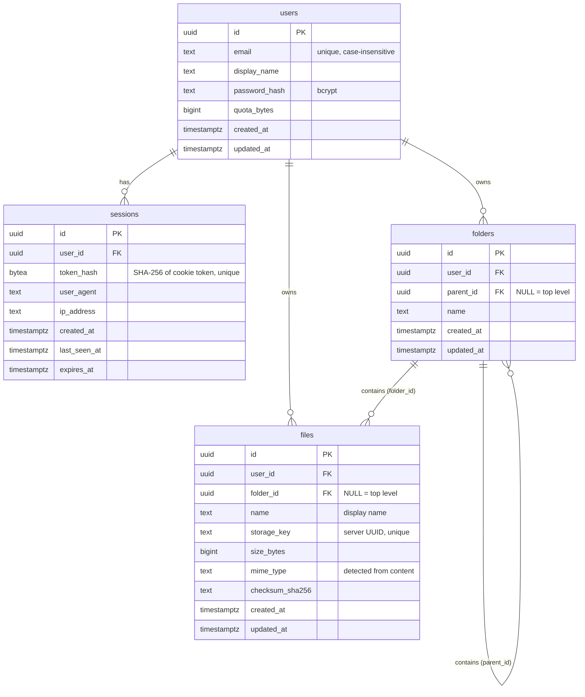

# Database

PostgreSQL 13+ (developed and tested on PostgreSQL 17). The schema is created by versioned SQL migrations in [`database/migrations/`](../database/migrations).

## Entity diagram

Plus `schema_migrations(version, filename, checksum, applied_at)`, maintained by the migration runner.

## Tables

### `users`
| Column | Type | Notes |
|---|---|---|
| `id` | `uuid` PK | `gen_random_uuid()` |
| `email` | `text` | 3–254 chars; **unique on `lower(email)`** |
| `display_name` | `text` | 1–80 chars |
| `password_hash` | `text` | bcrypt hash; plaintext is never stored |
| `quota_bytes` | `bigint` | ≥ 0; set from `DEFAULT_QUOTA_MB` at registration (can be changed per user) |
| `created_at`, `updated_at` | `timestamptz` | `updated_at` maintained by trigger |

### `sessions`
| Column | Type | Notes |
|---|---|---|
| `id` | `uuid` PK | |
| `user_id` | `uuid` FK → `users` | `ON DELETE CASCADE` |
| `token_hash` | `bytea` UNIQUE | SHA-256 of the cookie token |
| `user_agent`, `ip_address` | `text` | informational |
| `created_at`, `last_seen_at` | `timestamptz` | `last_seen_at` updated at most every 5 min |
| `expires_at` | `timestamptz` | indexed; expired rows are purged |

### `folders`
| Column | Type | Notes |
|---|---|---|
| `id` | `uuid` PK | |
| `user_id` | `uuid` FK → `users` | `ON DELETE CASCADE` |
| `parent_id` | `uuid` | `NULL` = top level |
| `name` | `text` | 1–255 chars |

Constraints:
- `CHECK (parent_id <> id)` — a folder can't be its own parent.
- `UNIQUE (id, user_id)` — target for the composite foreign keys.
- `FOREIGN KEY (parent_id, user_id) REFERENCES folders (id, user_id) ON DELETE CASCADE` — the parent must belong to the **same user**; deleting a folder deletes its subtree.
- Unique index on `(user_id, COALESCE(parent_id, '0000…'), lower(name))` — no duplicate sibling names (case-insensitive), including at the top level, where `parent_id` is NULL. Plain `UNIQUE` would treat NULLs as distinct; `COALESCE` fixes that and also works before PostgreSQL 15's `NULLS NOT DISTINCT`.

### `files`
| Column | Type | Notes |
|---|---|---|
| `id` | `uuid` PK | |
| `user_id` | `uuid` FK → `users` | `ON DELETE CASCADE` |
| `folder_id` | `uuid` | `NULL` = top level |
| `name` | `text` | display name, 1–255 chars |
| `storage_key` | `text` UNIQUE | server-generated UUID naming the bytes on disk |
| `size_bytes` | `bigint` | ≥ 0 |
| `mime_type` | `text` | detected from content (see architecture) |
| `checksum_sha256` | `text` | 64 lowercase hex chars (CHECK) |

Constraints:
- `FOREIGN KEY (folder_id, user_id) REFERENCES folders (id, user_id) ON DELETE CASCADE` — a file can only be in a folder of its owner.
- Unique index on `(user_id, COALESCE(folder_id, '0000…'), lower(name))` — no duplicate names within a folder.

## Indexes

| Index | Purpose |
|---|---|
| `users_email_lower_key` | Case-insensitive unique email, login lookup |
| `sessions.token_hash` (unique) | Session lookup on every request |
| `sessions_user_id_idx`, `sessions_expires_at_idx` | Cascade deletes, expiry cleanup |
| `folders_sibling_name_key` | Uniqueness, and listing a folder's children by user |
| `folders_parent_id_idx` | Recursive subtree queries, cascades |
| `files_sibling_name_key` | Uniqueness, and listing a folder's files |
| `files_folder_id_idx` | Cascades from folders, subtree file lookup |
| `files_user_created_idx` | "Recently uploaded" on the overview |

## Design decisions

- **UUID primary keys.** Ids appear in URLs; random UUIDs can't be enumerated, so `…/files/1`, `…/files/2` can't be walked. (Authorization is still enforced separately; unguessable ids are defence in depth, not the protection.)
- **Adjacency list for folders** (`parent_id`) with **recursive CTEs** for breadcrumbs, subtree checks and subtree deletes. It's simple to understand and update (a move is one `UPDATE`), and personal folder trees are shallow. Nesting is capped at 32 levels in the service layer, and recursive queries have depth guards.
- **Usage is computed, not stored.** Storage used is `SUM(size_bytes)`, so there is no counter to drift out of sync. Quota checks run under the per-user row lock (`SELECT … FROM users … FOR UPDATE`), which makes them race-free.
- **Metadata in the database, bytes outside it.** Keeps the database small and backups cheap, and lets bytes move to object storage later. `storage_key` is never derived from user input.
- **Cascade deletes** keep the tree consistent: deleting a user removes their sessions, folders and files; deleting a folder removes its subtree. The service collects storage keys *before* deleting so the bytes can be removed afterwards.
- **`timestamptz` everywhere**; `updated_at` is maintained by a trigger, not by application code.

## Migrations

- Files are named `NNN_description.sql` and applied in order, each in its own transaction.
- Applied migrations are recorded in `schema_migrations` with a SHA-256 checksum. If an applied migration file is later edited, the runner stops with an error: **create a new migration instead of editing an old one**.
- A PostgreSQL advisory lock prevents two processes from migrating at once.
- Run with `npm run db:migrate`. The API also applies pending migrations on startup.
- The test suite applies migrations to the separate `myowncloud_test` database before running.

Current migrations:

| Version | File | Contents |
|---|---|---|
| 001 | `001_initial_schema.sql` | users, sessions, folders, files, indexes, triggers |
